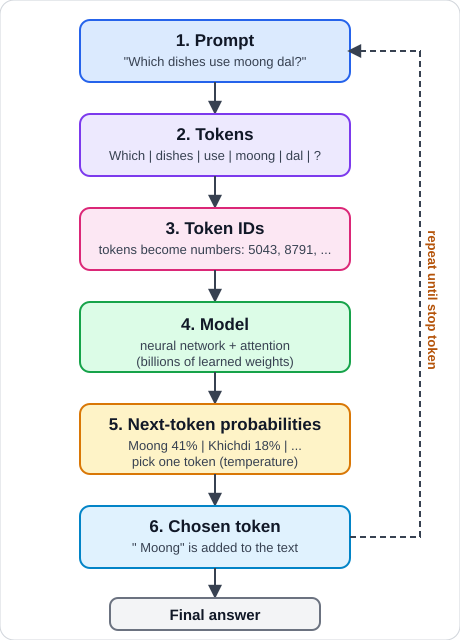

# How LLMs Work (in my own words)

A large language model (LLM) is a program that has read a huge amount of text and learned one skill: **given some text, guess what comes next.** Everything a chatbot does, including answering questions, writing code and summarising, is built on repeating that one guess many times.

## The diagram



Text version of the same flow:

```
prompt -> tokens -> model -> next token -> (add it to the prompt, repeat) -> answer
```

## Step by step

1. **Prompt.** This is the text I send in: my question, plus any instructions or data I paste in.
2. **Tokens.** The model cannot read letters or words directly. A tokenizer cuts the text into small pieces called tokens (a whole word, part of a word, or punctuation) and turns each into a number. "Moong dal" might become 2 or 3 tokens.
3. **Model.** The numbers go through a neural network. During training, it adjusted billions of internal numbers (weights) so that it got better at predicting the next token in real text. It uses attention to decide which earlier tokens matter most for the next guess.
4. **Next token.** The output is not one answer but a list of probabilities for every possible next token. One is chosen. A setting called temperature controls how adventurous the choice is: low means the most likely token almost every time, high means more variety.
5. **Loop.** The chosen token is added to the end of the text and the whole process runs again, one token at a time, until the model produces a stop token.

## What this means in practice

- **The model predicts plausible text, it does not look facts up.** If the answer is not in its training or in the prompt, it may still produce a confident-sounding wrong answer. This is called hallucination.
- **It only knows what is in the prompt (context window) and its training.** It has not seen my `records.json` unless I put that data into the prompt.
- **Same question can give different answers,** because the next token is chosen from probabilities.
- **Tokens cost time and money,** and there is a limit to how many fit in the context window.

## Why this matters for ThaliPlanner

My app has 20 recipes in `data/records.json`. If I ask an LLM a question about them, it should answer **from that data**, not from memory. So the plan is: find the matching recipes first (my TF-IDF `smart_search`), put them into the prompt, and tell the model to answer only from them. If the data has nothing relevant (for example calories, which I do not store), the right behaviour is to say "I don't have that information" instead of guessing. Question 6 in `eval/questions.md` tests exactly this.
